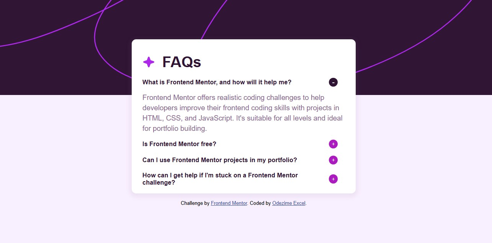

# Frontend Mentor - FAQ accordion solution

This is a solution to the [FAQ accordion challenge on Frontend Mentor](https://www.frontendmentor.io/challenges/faq-accordion-wyfFdeBwBz). Frontend Mentor challenges help you improve your coding skills by building realistic projects. 

## Table of contents

- [Overview](#overview)
  - [The challenge](#the-challenge)
  - [Screenshot](#screenshot)
  - [Links](#links)
- [My process](#my-process)
  - [Built with](#built-with)
  - [What I learned](#what-i-learned)
- [Author](#author)

## Overview

### The challenge

Users should be able to:

- Hide/Show the answer to a question when the question is clicked
- Navigate the questions and hide/show answers using keyboard navigation alone
- View the optimal layout for the interface depending on their device's screen size
- See hover and focus states for all interactive elements on the page

### Screenshot




### Links

- Solution URL: [view](https://github.com/master-x2000/faqapp)
- Live Site URL: [view](https://master-x2000.github.io/faqapp)

## My process

### Built with

- Semantic HTML5 markup
- CSS custom properties
- Flexbox
- JavaScript
- Desktop-first workflow
- Google Fonts

### What I learned

It was abit challenging to select the individual view icons but by selecting it directly from the question selected I was able to change the state of the view icon

```js
questions.forEach(question => {
    question.addEventListener("click", event => {
        // To display the answer
        question.classList.toggle("show-answer");
        const viewState = question.querySelector(".view");

        // To change icon 
        if(question.classList.contains("show-answer")){
            console.log("no-view");
            viewState.style.backgroundColor = "#2f1533";
            viewState.style.fontSize = "1rem";
            viewState.textContent = "-";
        } else {
            console.log("view");
            viewState.style.backgroundColor = "#ac1bbf";
            viewState.textContent = "+";
        }
    });
});
```

## Author

- Frontend Mentor - [@yourusername](https://www.frontendmentor.io/profile/master-x2000)
- Twitter - [@yourusername](https://www.twitter.com/EIdezime66661)
